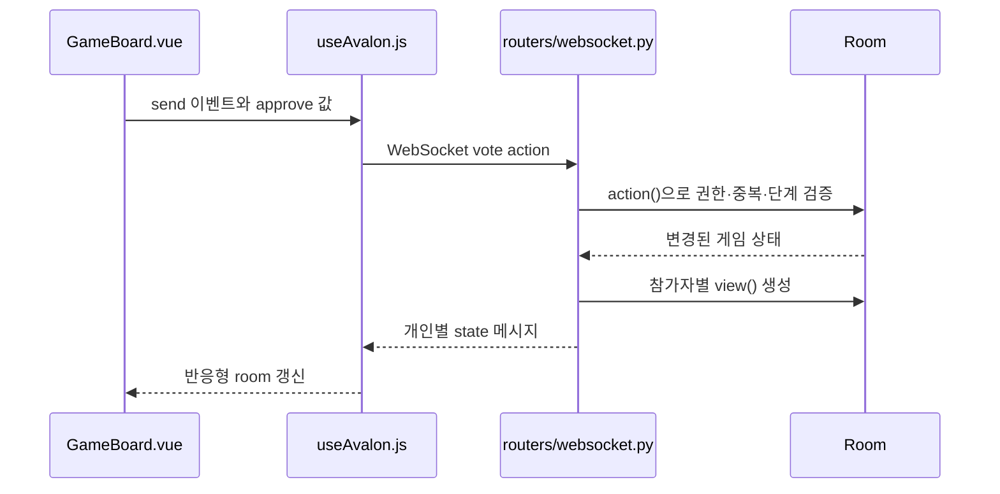

# AVALON COURT · 레지스탕스 아발론

Vue 3 + FastAPI + MySQL + Docker Compose로 실행하는 5~10인 실시간 추리 게임입니다. 회원가입 없이 닉네임으로 입장하며, 원탁 화면·비밀 역할 카드·투표·원정·채팅·장면별 음악을 제공합니다.

## 처음 실행하기

Docker Desktop 또는 Docker Engine/Compose를 실행한 뒤, 이 README와 `compose.yaml`이 있는 폴더에서 실행합니다.

```sh
python scripts/init_env.py
docker compose up --build -d
```

Windows에서 `python` 명령 대신 Python Launcher를 사용한다면 `py scripts/init_env.py`로 실행합니다. 접속 주소는 http://localhost:8080 입니다. 첫 빌드에는 이미지와 패키지 다운로드를 위한 인터넷 연결이 필요합니다.

기존 `.env`는 덮어쓰지 않습니다. 업데이트할 때는 기존 `.env`와 Compose 프로젝트 이름을 유지하고 `docker compose up --build -d`를 실행합니다. DB를 보존하려면 `docker compose down -v`를 사용하지 않습니다. 자세한 설치·업데이트·다른 기기 접속 방법은 [실행 안내](RUN_GUIDE.md)를 확인하세요.

## 학습을 시작할 위치

| 알고 싶은 내용 | 먼저 볼 파일/안내 | 이어서 볼 곳 |
|---|---|---|
| 전체 서비스가 함께 뜨는 방법 | [compose.yaml](compose.yaml) | frontend/backend의 Dockerfile |
| Vue 화면의 구성 | [프론트 학습 안내](frontend/README.md) | main.js, App.vue, pages |
| 준비·투표·채팅이 서버에 전달되는 방법 | [composables 안내](frontend/src/composables/README.md) | useAvalon.js, backend/app/routers |
| 실제 게임 규칙과 비밀 정보 | [도메인 안내](backend/app/domain/README.md) | game.py의 action(), view() |
| DB 저장·설정·세션 | [서버 기반 기능](backend/app/core/README.md) | database.py, config.py, security.py |
| 음악과 효과음 | [정적 파일 안내](frontend/public/README.md) | useAudio.js, audio.js |
| 코드가 맞는지 확인하는 방법 | [검증 안내](TEST_REPORT.md) | frontend/tests, backend/tests |

폴더마다 있는 README는 그 폴더의 책임, 주요 파일, 연결되는 상위/하위 계층, 학습 포인트를 설명합니다. 전체 코드를 한 번에 읽기보다 아래 행동 하나를 끝까지 따라가는 것이 좋습니다.

## 한 번의 투표가 처리되는 흐름



프론트의 버튼은 행동을 요청하고, **최종 규칙은 서버가 검증**합니다. 서버의 내부 Room 전체를 보내지 않고 `view(pid)`로 각 참가자에게 허용된 정보만 보냅니다. 화면·음악·연출은 받은 상태를 보여주는 역할이며, 서버의 승패나 제한시간을 바꾸지 않습니다.

## 폴더 역할

| 위치 | 책임 |
|---|---|
| [frontend/src](frontend/src/README.md) | Vue 화면, 상태, HTTP/WS 통신, 오디오, 공개 연출 |
| [frontend/public](frontend/public/README.md) | 실행 화면이 읽는 이미지 38개와 음원 17개 |
| [backend/app](backend/app/README.md) | FastAPI 조립, 라우터, 규칙, DB, 세션 |
| [backend/tests](backend/tests/README.md) | 게임 규칙과 HTTP/WebSocket 통합 검사 |
| [frontend/tests](frontend/tests/README.md) | 이벤트 선택·비밀 정보·오디오 수명 주기 검사 |
| [scripts](scripts/README.md) | 최초 실행용 환경변수 생성 |

## 어디를 고치면 될까?

| 변경하고 싶은 것 | 파일 |
|---|---|
| 로비·게임·도감 페이지 배치 | frontend/src/pages/*.vue |
| 원탁·좌석·원정/투표 버튼 | frontend/src/components/game/*.vue |
| 채팅 정렬·자동 스크롤 | frontend/src/components/game/ChatPanel.vue, style.css |
| 방 생성·입장·재접속 | frontend/src/composables/useAvalon.js |
| 음악 선택·페이드·효과음 제한 | frontend/src/audio.js |
| Vue 상태와 오디오의 연결 | frontend/src/composables/useAudio.js |
| 역할명·설명·이미지 경로 | frontend/src/constants/game.js |
| 참가 인원·원정 인원·승패 판정 | backend/app/domain/game.py |
| API 입력·세션·Origin 검증 | backend/app/schemas.py, routers, core |

`.vue` 파일의 `props`는 부모에게 받은 값이고 `emit`은 부모에게 알리는 행동입니다. `ref`의 값이 바뀌면 화면이 갱신됩니다. `computed`는 상태로부터 계산하고, `watch`는 상태 변경에 따른 오디오·연출 같은 부수효과를 실행합니다. 이 개념은 [프론트 학습 안내](frontend/README.md)에서 먼저 익힐 수 있습니다.

## 게임 진행과 정보 공개

- 5~10인, 멀린·암살자는 필수이며 퍼시벌·모르가나·모드레드·오베론은 방 설정으로 선택합니다.
- 전원 준비와 접속 후 방장이 시작합니다. 원정대 제안 → 전원 투표 → 승인 시 원정 카드 제출 → 공개 결과 순서입니다.
- 동수는 부결, 연속 5회 부결 또는 원정 3회 실패는 악 승리입니다. 7인 이상 4차 원정은 실패 카드 2장이 필요합니다.
- 원정 3회 성공 뒤 암살자가 멀린을 맞히면 악, 틀리면 선이 승리합니다.
- 본인 역할은 직접 확인할 때만 표시하며, 공개 좌석은 같은 중립 기사 이미지를 사용합니다. 개인별 찬반이나 실패 카드 제출자는 공개하지 않습니다.
- 연결이 끊기면 유예시간 동안 일시정지하며, 복귀하면 제한시간을 보정합니다. 명시적 퇴장·유예 만료·행동 시간 초과·서버 재시작 등은 승패 없는 무효 종료가 될 수 있습니다.

## 운영할 때 알아둘 점

MySQL은 방 상태와 익명 세션을 저장하지만 진행 중 연결과 방 객체는 서버 프로세스가 관리합니다. Uvicorn worker는 **1개**를 유지합니다. DB의 Room 스냅샷에는 비밀 역할도 포함되므로 DB를 공개하지 않습니다.

다른 기기·도메인에서 접속하려면 `.env`의 `ALLOWED_ORIGINS`에 실제 Origin을 추가해야 합니다. 같은 브라우저 프로필의 탭은 세션 쿠키를 공유하므로 다인 테스트에는 독립 프로필 또는 기기를 사용합니다.

음악은 `소리 설정 → 소리 켜기`로 활성화합니다. 이미지·음원은 로컬 파일이며 외부 미디어 계정이나 API 키가 필요 없습니다. [이미지 설명](ROLE_ART.md), [출처·라이선스](LICENSES_REMASTER.md)를 참고하세요.

## 검증

프론트 테스트는 프로젝트 루트에서 `node --test frontend/tests/*.test.js`, 빌드는 `frontend`에서 `npm ci` 후 `npm run build`로 실행합니다. 백엔드 의존성을 설치한 환경에서는 `backend`에서 `python -m pytest -q tests`로 실행합니다. 자세한 검증 결과와 미검증 환경은 [TEST_REPORT.md](TEST_REPORT.md)에 있습니다.


## 전체 디렉터리 구조

```text
WebAvalonCourt/
├── README.md                       # 프로젝트 소개·학습 순서·전체 구조
├── RUN_GUIDE.md                    # 설치·실행·업데이트·다른 기기 접속 방법
├── ROLE_ART.md                     # 역할 이미지와 화면 컴포넌트 연결 설명
├── LICENSES_REMASTER.md            # 이미지·음악 출처와 이용 조건
├── TEST_REPORT.md                  # 검증 방법·결과·미검증 환경
├── compose.yaml                   # MySQL·FastAPI·Nginx 서비스 구성
├── .env.example                   # 환경변수 예시
│
├── scripts/
│   ├── README.md                  # 실행 보조 도구 설명
│   └── init_env.py                # 비밀값을 생성해 .env 초기화
│
├── frontend/                      # Vue 3 기반 브라우저 화면
│   ├── README.md                  # Vue 개념·프론트 구조 학습 안내
│   ├── Dockerfile                 # Vue 빌드 후 Nginx 이미지 구성
│   ├── nginx.conf                 # 정적 파일 제공·HTTP/WS 프록시
│   ├── package.json               # 의존성과 실행·빌드 명령
│   ├── package-lock.json          # 설치할 패키지 버전 고정
│   ├── vite.config.js             # Vue 빌드·개발 서버 프록시 설정
│   ├── index.html                 # Vue 앱이 붙는 HTML 진입점
│   │
│   ├── public/                    # 브라우저에 그대로 제공하는 정적 파일
│   │   ├── README.md
│   │   ├── assets/
│   │   │   ├── README.md
│   │   │   └── remaster/          # 실제 화면에서 사용하는 WebP 이미지
│   │   │       ├── README.md
│   │   │       ├── backgrounds/   # 성·회의실·호수·암살 배경
│   │   │       ├── board/         # 원탁·공개 좌석용 중립 기사
│   │   │       ├── cards/         # 봉인된 역할 카드 뒷면
│   │   │       ├── emblems/       # 왕실 문장
│   │   │       ├── roles/         # 역할 초상화·썸네일
│   │   │       ├── tokens/        # 찬반·원정 성공/실패 토큰
│   │   │       ├── results/       # 선·악 승리 배경
│   │   │       └── ui/            # 양피지·투명 카드 프레임
│   │   └── audio/
│   │       ├── README.md
│   │       ├── CREDITS.txt        # 소리 설정에서 열리는 출처 안내
│   │       ├── bgm/               # 장면별 배경음 OGG 6개
│   │       └── sfx/               # 이벤트 효과음 WAV 11개
│   │
│   ├── src/                       # 실제 프론트엔드 소스
│   │   ├── README.md
│   │   ├── main.js                # Vue 앱 생성·공통 스타일 로딩
│   │   ├── App.vue                # 페이지·상태·이벤트 조립
│   │   ├── style.css              # 공통 테마·배치·반응형·애니메이션
│   │   ├── audio.js               # 음원 재생·페이드·음량·합성 대체음
│   │   ├── presentation.js        # 공개 상태에 따른 이벤트 연출 선택
│   │   │
│   │   ├── pages/                 # 사용자가 보는 큰 화면 단위
│   │   │   ├── README.md
│   │   │   ├── LobbyPage.vue      # 닉네임·방 목록·검색·입장
│   │   │   ├── GamePage.vue       # 게임판·역할·채팅·설정 조립
│   │   │   ├── RulesPage.vue      # 게임 방법
│   │   │   └── RolesPage.vue      # 역할 도감
│   │   │
│   │   ├── components/            # 페이지를 구성하는 UI 부품
│   │   │   ├── README.md
│   │   │   ├── game/
│   │   │   │   ├── README.md
│   │   │   │   ├── GameBoard.vue      # 단계별 행동·원정대 선택·제출
│   │   │   │   ├── RoundTable.vue     # 원탁과 참가자 좌석 배치
│   │   │   │   ├── PlayerSeat.vue     # 참가자 공개 상태 표시
│   │   │   │   ├── QuestTrack.vue     # 원정 진행·결과 표시
│   │   │   │   ├── IdentityPanel.vue  # 본인 역할·비밀 정보 확인
│   │   │   │   ├── RolePortrait.vue   # 역할 이미지·프레임·실패 안내
│   │   │   │   ├── LobbySettings.vue  # 방장 설정 입력·저장 요청
│   │   │   │   ├── ChatPanel.vue      # 채팅·기록·자동 스크롤
│   │   │   │   ├── EventOverlay.vue   # 공개 이벤트 배너
│   │   │   │   └── GameResult.vue     # 종료 결과·전체 역할 공개
│   │   │   ├── lobby/
│   │   │   │   ├── README.md
│   │   │   │   └── RoomModal.vue      # 방 생성·입장 입력 모달
│   │   │   └── layout/
│   │   │       ├── README.md
│   │   │       ├── AppHeader.vue      # 로고·페이지 이동
│   │   │       ├── ErrorBanner.vue    # 오류 메시지
│   │   │       └── SoundControls.vue  # 소리 활성화·음량·출처 링크
│   │   │
│   │   ├── composables/           # Vue 상태와 동작을 묶은 함수
│   │   │   ├── README.md
│   │   │   ├── useAvalon.js       # 방 관리·REST·WS·재접속·타이머
│   │   │   └── useAudio.js        # Vue 상태·사용자 조작과 오디오 연결
│   │   ├── services/
│   │   │   ├── README.md
│   │   │   └── api.js             # REST 요청·JSON·오류 공통 처리
│   │   └── constants/
│   │       ├── README.md
│   │       └── game.js            # 역할명·설명·단계·규칙표·이미지 경로
│   │
│   └── tests/
│       ├── README.md
│       ├── audio.test.js          # 상태 변화에 따른 효과음 선택
│       ├── audio-engine.test.js   # 로딩 경쟁·음소거·전환·종료 정리
│       └── presentation.test.js   # 공개 연출·비밀 정보·중복 억제
│
└── backend/                       # FastAPI 기반 게임 서버
    ├── README.md                  # 서버 구조·핵심 개념 학습 안내
    ├── Dockerfile                 # Python 의존성 설치·Uvicorn 실행
    ├── requirements.txt           # 서버·DB·테스트 의존성
    │
    ├── app/
    │   ├── README.md
    │   ├── __init__.py            # Python 패키지 선언
    │   ├── main.py                # ASGI 진입점
    │   ├── factory.py             # FastAPI 앱·미들웨어·라우터 조립
    │   ├── lifecycle.py           # 시작·종료·상태 복원·시계 태스크
    │   ├── schemas.py             # API 입력 형식·범위 검증
    │   ├── state.py               # 프로세스 내 방·연결·공유 잠금
    │   │
    │   ├── core/                  # 서버 기반 기능
    │   │   ├── README.md
    │   │   ├── __init__.py
    │   │   ├── config.py          # 환경변수 읽기·서버 설정
    │   │   ├── database.py        # DB 연결·세션 및 방 상태 저장
    │   │   └── security.py        # 세션 토큰·비밀번호 다이제스트
    │   ├── domain/                # 네트워크·DB와 분리된 게임 규칙
    │   │   ├── README.md
    │   │   ├── __init__.py
    │   │   └── game.py            # Player·Room·행동·승패·정보 공개
    │   ├── routers/               # 외부 요청 진입점
    │   │   ├── README.md
    │   │   ├── __init__.py
    │   │   ├── http.py            # 익명 세션·방 생성/입장/설정/퇴장
    │   │   └── websocket.py       # 준비·투표·원정·채팅 실시간 처리
    │   └── services/              # 여러 계층에서 공유하는 업무 처리
    │       ├── README.md
    │       ├── __init__.py
    │       ├── session_service.py # 익명 세션 생성·조회
    │       ├── room_service.py    # 방 조회·설정·참가 상태 검증
    │       └── realtime.py        # 개인별 상태 전송·서버 시계
    │
    └── tests/
        ├── README.md
        ├── test_game.py           # 역할·원정·투표·승패·연결 규칙
        └── test_api.py            # HTTP·쿠키·WebSocket 통합 검사
```

### 구조를 이해하는 핵심

- **화면 표시**는 `pages`와 `components`가 담당합니다.
- **브라우저 상태와 통신**은 `useAvalon.js`가 담당합니다.
- **최종 게임 규칙과 정보 공개 범위**는 서버의 `domain/game.py`가 결정합니다.
- **라우터**는 요청을 받고, **서비스**는 공통 업무를 처리하며, **core**는 DB·설정·보안을 제공합니다.
- **이미지·음원**은 `frontend/public`에서 제공하고, 재생과 연출 코드는 서버 상태를 관찰해 동작합니다.

실행 중 생성되는 `.env`, 설치되는 `node_modules`, 빌드 결과 `dist`는 위 소스 구조와 별도로 관리합니다.